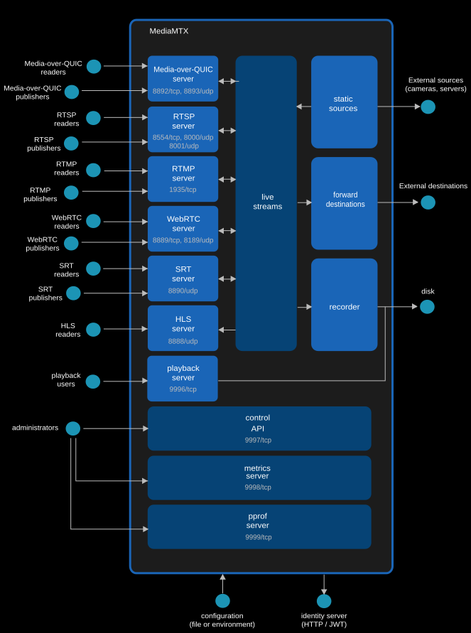

# Architecture

## Live streams

The main purpose of _MediaMTX_ is to serve real-time media streams. Each stream is mapped to a unique _Path_, for instance there can be a stream on path `/stream1` and a different one on `/stream2`.

Streams can be [published and read](03-publish-and-read.md) by using a client that connects to _MediaMTX_ and communicates through a protocol, or even by using _MediaMTX_ as the client that connects to an existing server and pulls the stream (_Static sources_).

## Recorder

Streams ingested into _MediaMTX_ can be passed to a recorder to [record their content to disk](08-record.md).

## Playback server

Recordings produced by the recorded can be served back to users through the [playback server](09-playback.md).

## Forward destinations

Streams ingested into _MediaMTX_ can be forwarded to other servers by using [forward destinations](10-forward.md).

## Administrative utilities

_MediaMTX_ provides some utilities that are meant to be used by administrators to monitor and control the software:

- The [Control API](20-control-api.md), that offers an API to query and change the configuration and the state of the server.
- The [Metrics server](21-metrics.md), that serves metrics in a standard format.
- The [Pprof server](22-performance.md) that allows to extract CPU and memory usage.
